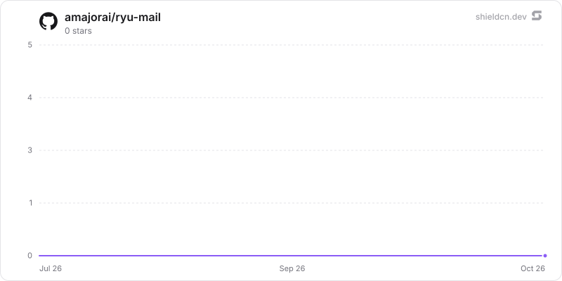

<div align="center">

# mail

</div>

Email-as-a-service for agents (receive, store, and send agent email per node). The out-of-process ryu-mail sidecar; Core proxies /api/mail/* to it.

> **The public home of `ryu-mail`.** Source, builds, and releases live here —
> binaries for every platform are attached to each release.
>
> This tree is generated from the Ryu monorepo, so commits pushed here
> directly are replaced on the next sync. **Pull requests are welcome** —
> open them here and they are ported into the monorepo, then flow back out.
> Ryu as a whole: https://github.com/amajorai/ryu

## Install

**App:** [Install](ryu://apps/com.ryu.mail) (opens the Ryu desktop app and asks you to confirm)

**CLI:**

```bash
ryu apps add com.ryu.mail
```

**From source:**

```bash
cargo build --release --manifest-path backend/Cargo.toml
```

Prebuilt binaries for every platform are attached to [each release](https://github.com/amajorai/ryu/releases).

## License

Apache-2.0 — see [LICENSE](./LICENSE).

## Parts

- **`backend/` — `ryu-mail` (out-of-process sidecar).** A standalone Axum binary
  (its own crate, ZERO dependency on `apps/core`) that owns `mail.db`: inbox
  registry, message store, MIME assembly, and SMTP send (`lettre`) + inbound parse
  (`mail-parser`). Core spawns it (`SidecarProcess::Local`, host/sibling binary,
  no download), health-checks `/health`, and proxies `/api/mail/*` to it
  on loopback. Route paths are byte-identical to Core's old in-process routes so
  the proxy passes straight through.
- **Companion (`@ryu/mail-app`).** A sandboxed full-page Companion
  (Path B, `ui_format: "html"`), built to one self-contained `dist/index.html` via
  `vite-plugin-singlefile`. A per-node mail client: list inboxes, read messages,
  compose/send, create an inbox (revealing its inbound webhook secret + forwarder
  URL). Every call goes over the `window.ryu` bridge, never `fetch`. Its source
  lives in the Ryu monorepo next to this backend and ships inside the Ryu node;
  the standalone service does not need it.

## Manifest (`manifest.json`)

- **Capability grant:** `mail:crud` — the bridge capability the companion calls.
- **Sidecar:** `ryu-mail` on `:7996`, `command_env: RYU_MAIL_BIN`,
  `port_env: RYU_MAIL_PORT`, `http.public_mount: /api/mail` (a built-in owning a
  stable external URL), `max_body_bytes` 26 MiB (Core's proxy ceiling; the
  sidecar itself accepts 25 MiB of inbound MIME and 12 MiB JSON requests carrying
  up to 8 MiB of decoded attachments).
- **Runnable:** one `companion` (`Agent Inboxes`, icon `mail-01`).
- **App events (`contributes.hook_events`):** `@ryu/mail#message.received` and
  `@ryu/mail#message.sent`, raised by the sidecar through `events.emit` so a
  plugin hook or workflow can react to mail without either side knowing the other
  exists. Both carry **metadata only** (ids, addresses, subject, timestamps) — the
  fan-out payload reaches every subscriber verbatim, so bodies stay behind the
  authed `GET /api/mail/messages/:id`. `message.sent` marks SMTP hand-off, not
  delivery.

## Run as a standalone service

The same `ryu-mail` binary can serve one independently deployed Mail tenant. Set
an explicit standalone token and bind address; the standalone token is separate
from Core's injected `RYU_EXT_TOKEN`:

Building needs a Rust toolchain, `pkg-config`, and the OpenSSL development
headers (`libssl-dev` on Debian/Ubuntu). Run from the directory that contains
`backend/` (the root of the `ryu-mail` repository):

```sh
export RYU_MAIL_API_TOKEN="$(openssl rand -hex 32)"
RYU_MAIL_MODE=standalone \
RYU_MAIL_HOSTNAME=0.0.0.0 \
RYU_MAIL_PORT=7996 \
RYU_PLUGIN_DATA_DIR=/var/lib/ryu-mail \
cargo run --manifest-path backend/Cargo.toml
```

A bind beyond loopback needs a token of at least 32 characters that is not a
placeholder. SMTP uses `RYU_SMTP_TLS=starttls` by default (`implicit` on port
465); `none` is accepted only for a relay on the same host.

The existing `/api/mail/*` API is available directly. Put TLS, rate limiting,
and the inbound mail provider in front of the service. Standalone mode is
single-tenant: the configured bearer can read and manage every inbox in that
service's database. Incoming messages still require the per-inbox HMAC secret;
they do not use the bearer token.

Inbox inbound secrets, webhook signing secrets, and webhook header values are
always stored encrypted (ChaCha20-Poly1305 under the `@ryu/mail` plugin subkey).
Under Ryu Core the sidecar receives that subkey at spawn; a standalone service
derives it from `RYU_MASTER_KEY` (base64 of 32 random bytes, e.g.
`openssl rand -base64 32`) or, without it, generates a root key in
`<data dir>/secrets/standalone-root.key` (0600) on first start and pins its key
check value. Keep supplying the same key (or keep that file with the data): a
store sealed under one key does not start with another, and a store with
encrypted secrets does not start without a key. Rows from an older
version (plaintext, or sealed with the previous `RYU_MASTER_KEY` scheme) are
resealed on the first start that has the key. Relays should sign `X-Ryu-Timestamp` with each inbound
delivery so captured requests cannot be replayed, and an inbox can require it
(`require_timestamp`). Outbound event webhooks use Standard Webhooks signatures.

The standalone root `GET /` returns a short tokenless JSON description (`name`,
`version`, and the `/health` path). It redirects to `RYU_PRODUCT_DASHBOARD_URL`
only when that variable is set to a non-empty URL; Ryu's hosted deployment sets
it to the Ryu organization dashboard. A self-hosted Mail never sends its
visitors to Ryu by default. The `/api/mail/*` API and inbound webhook remain
available for service callers.

`RYU_MAIL_API_TOKEN` must be present before a non-loopback bind is allowed. A
Core-issued token is accepted only for the loopback sidecar path and is never a
standalone credential.

## Auth / security

Core-hosted mode binds **loopback only** and fail-closes: protected `/api/mail/*`
routes require the shared-secret bearer Core injects at spawn. Standalone mode
uses `RYU_MAIL_API_TOKEN` with the same protected routes. The inbound webhook
(`POST /api/mail/inbound/:id`) keeps its own per-inbox HMAC-SHA256 auth and is
reachable tokenless.

## Swap seam

Mail scales and fails independently of the node. Because the backend is a separate
process behind a stable `/api/mail/*` contract, any equivalent mail backend can
replace `ryu-mail` without touching Core.

## At rest

Message content is sealed with the same `@ryu/mail` plugin subkey (`encb:v1:` per value,
store `mail.db`, AAD bound to the row id): every message's subject, text, html, extracted
text and html, preview, headers and address lists (from, to, cc, bcc, reply-to); every
draft's address lists, subject, text, html, headers and attachments (base64 content
included); attachment file names; event payloads (`mail_events.payload`); and stored send
and idempotency responses. Attachments and raw MIME are write-once `RYU-SF01` files: the
file name stays the SHA-256 of the plaintext, so duplicate attachments still share one blob;
the name is bound into the AAD and checked against the decrypted bytes on every read.
Downloads decrypt through the store (`read_attachment`, `read_raw`).

Plaintext on purpose: ids, inbox ids, `Message-ID`/`In-Reply-To`/thread ids (duplicate
detection and threading query them), labels, statuses, read/opened flags, sizes and
timestamps; inbox names and addresses; allow/block list entries (`address_allowed` matches
them in SQL); webhook URLs. Text search (`q`) already ran in memory over the listed page and
still does after decrypt. The blob names reveal which messages share an attachment.

Migration: legacy rows are sealed when the store opens (`ryu_crypto::content_sqlite`,
cursor-paginated, compare-and-swap, resumable and idempotent; on a background connection
when the store holds more than 5,000 messages), then freed pages are scrubbed
(`secure_delete = ON` on every connection, WAL truncate, freelist scrub, `VACUUM` when it
fits, otherwise at the next start). The sidecar seals legacy blob files in place in the
background (each sealed copy verified before it replaces the original; short disk space
defers it). `/health` reports `sealing.state` and `sealing.unreadable_rows`; a list skips
and counts a row that does not open, a get of one fails.

Key states (`backend/src/seal_keys.rs`): with Core's key or `RYU_MASTER_KEY` or the
standalone root, content is sealed; a store sealed under a different key refuses to start
(before anything is resealed). Under an older Core that delivers no key, a never-sealed
store keeps storing content in plaintext (`sealing.state = "compat"`, "waiting for a Ryu
update") and secret writes fail closed as before; a store that already holds sealed content
opens with writes refused. The standalone satellite mirror builds `ryu-crypto` from
crates.io at the declared version, so the release train that ships this must publish
`ryu-crypto` first (already ordered before app backends in `tools/publish-crates.sh`).

## Star History

<a href="https://github.com/amajorai/ryu-mail/stargazers">
  <picture>
    <source media="(prefers-color-scheme: dark)" srcset="./.github/shieldcn/star-chart-dark.svg" />
    
  </picture>
</a>
